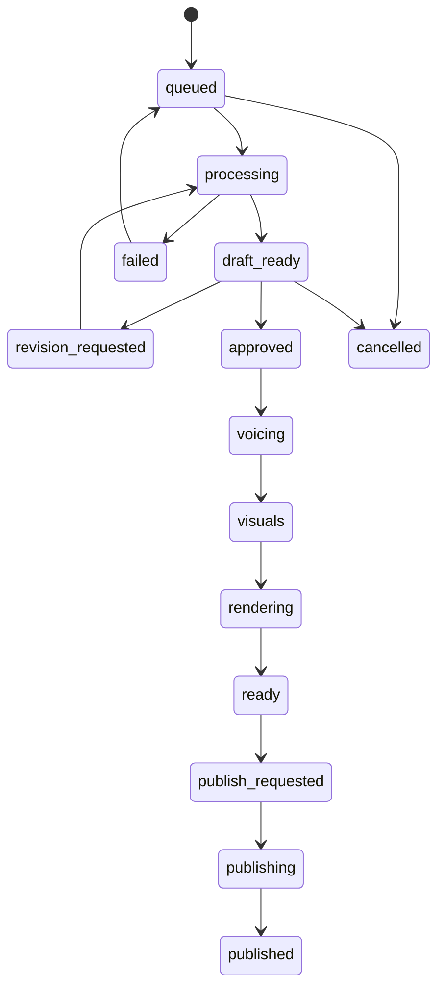

# Реализация UX-аудита Kontent Zavod

Этот документ связывает исправления с аудитом пользовательского пути
«первый запуск → готовое вертикальное видео → публикация».

## Матрица исправлений

| Пункт аудита | Исправление | Проверка | Статус |
|---|---|---|---|
| P0: `inbox/topic.txt` перезаписывал предыдущий заказ | Telegram создаёт отдельную запись `orders` в SQLite; worker атомарно забирает один заказ | `test_durable_order_queue_keeps_all_topics` создаёт и извлекает 10 разных заказов | Готово |
| P0: разные `run_id`, `trigger_id` и `source_id` | Единый `order_id` хранится в заказе, `SourceMeta`, карточках, callback и `PublishMeta` | Тесты очереди и переходов состояний | Готово |
| P0: несколько тем могли остаться после одного trigger | После обработки worker создаёт следующий wake-up trigger, пока есть runnable orders; каталог `triggers` примонтирован в контейнеры | Тест очереди + проверка compose | Готово |
| P1: Telegram отвечал только после cron | Отдельный сервис `telegram-bot` работает через long polling; старый cron-poller отключён | `test_check_telegram_topic_script_exists` | Готово |
| P1: любой текст становился новым роликом | В состоянии `idle` бот спрашивает «Создать из сообщения?»; прямой запуск остаётся только через `/topic` | `test_telegram_topic_intake_helpers` | Готово |
| P1: нет меню и команд управления | Добавлены `Создать Reels`, `Мои заказы`, `Помощь`, `/new`, `/orders`, `/status`, `/cancel` | `test_telegram_menu_callbacks_are_explicit` | Готово |
| P1: нет выбора формата | После темы предлагаются `Автоматически`, `Faceless`, `С аватаром`, `Гибрид`; выбор хранится в заказе | Проверка callback-клавиатуры и модели заказа | Готово |
| P1: сценарий нельзя проверить до затратного рендера | Pipeline останавливается в `draft_ready`; ElevenLabs, HeyGen, Pexels и FFmpeg запускаются только после approve | `test_topic_pipeline_stops_before_paid_stages_until_approval` | Готово |
| P1: нельзя исправить сценарий | Кнопка `Изменить` переводит сессию в `awaiting_revision`; новая версия использует предыдущий сценарий и инструкцию | `test_order_approval_revision_cancel_and_retry` | Готово |
| P1: нет статуса/повтора/отмены | Одна status-card редактируется по этапам; добавлены cancel и retry с owner check и идемпотентным approve | Тест переходов заказа | Готово |
| P2: mp4 назывался опубликованным Reels | Финал называется «готовое вертикальное видео»; внешний publish выполняется отдельной кнопкой | `test_publish_requires_ready_order_and_is_resumable` | Готово |
| P2: технические сообщения перегружали пользователя | Для Telegram-заказа скрыты сырой brief/research и stack error; пользователю показываются этап и recovery action | Проверка веток `meta.order_id` в pipeline | Готово |
| P2: нет понятной инструкции | README содержит путь от `/start` до готового mp4 и команды восстановления | Review README | Готово |

## Состояния заказа

## Пользовательский путь после исправлений

1. `/start` показывает меню.
2. `Создать Reels` переводит бота в ожидание темы.
3. Пользователь отправляет текст или голосовое и выбирает формат.
4. Бот создаёт устойчивый номер заказа и показывает статус `В очереди`.
5. Worker исследует тему и создаёт сценарий.
6. Бот показывает сценарий и ждёт `Принять`, `Изменить` или `Отменить`.
7. Только после `Принять` запускаются озвучка, визуалы и рендер.
8. Пользователь получает mp4, caption и хэштеги.
9. Кнопка `Опубликовать` отдельно запускает подключённые внешние площадки.

## Осознанно не включено в эту итерацию

- Webhook: long polling выбран как более простой и обратимый вариант для одного
  self-hosted бота; он уже убирает задержку cron без публичного HTTPS endpoint.
- Расчёт ETA по историческим данным: для этого сначала нужно накопить длительности
  этапов. Интерфейс не обещает выдуманное точное время.
- Полный setup wizard и продуктовая аналитика: это отдельные эпики после
  стабилизации очереди и state machine.
- Выбор конкретной внешней площадки в Telegram: первая версия публикует только
  на площадки, явно включённые через `PUBLISH_*`; сам запуск всегда требует
  отдельной кнопки пользователя.

## Связанный draft PR № 9

PR `Add Windows installation troubleshooting context notes` не относится к этим
исправлениям и не должен объединяться с UX-веткой. Рекомендация аудита остаётся:
закрыть его без merge либо перенести общую Windows-инструкцию в отдельную базу
знаний после устранения неточных формулировок про FAT32 и причинность Legacy/CSM.
